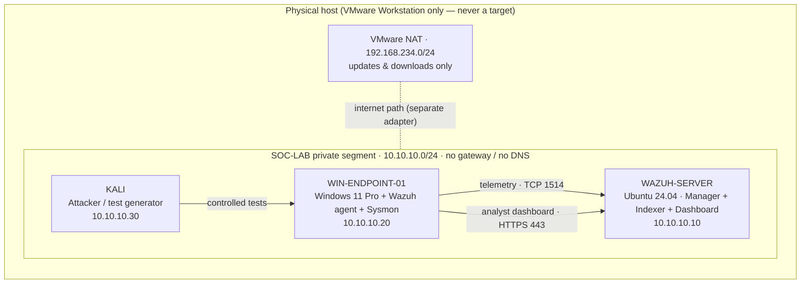

# Wazuh SOC Lab

A hands-on Security Operations Center (SOC) home lab built on **Wazuh SIEM/XDR**, documented phase by phase as it is built.

The lab runs three isolated VMs — an attacker (Kali), a monitored Windows 11 endpoint, and a Wazuh server — on a private network segment, so attacks, telemetry and investigations never touch the real host or home network.

> **Status:** Phases 0–8 complete ✅ (foundation, attack simulation, custom detection engineering, MITRE mapping) · Next: **Phase 9 – Threat hunting**

---

## Architecture



| VM | Role | OS | RAM | vCPU | Disk | SOC-LAB IP |
|---|---|---|---|---|---|---|
| WAZUH-SERVER | SIEM (manager, indexer, dashboard, Filebeat) | Ubuntu 24.04.4 | 6 GB | 4 | 60 GB | 10.10.10.10 |
| WIN-ENDPOINT-01 | Monitored endpoint | Windows 11 Pro | 4 GB | 2 | 64 GB | 10.10.10.20 |
| KALI | Attacker / test generator | Kali Linux | 2 GB | 2 | 75 GB | 10.10.10.30 |

Host: Intel i7-13650HX · 16 GB DDR5 · 1 TB NVMe. Kali stays powered off except during attack testing.

---

## Roadmap & progress

| # | Phase | Status | Write-up |
|---|---|---|---|
| 0 | Architecture & safety | ✅ Done | [phase-00](docs/phase-00-architecture-and-safety.md) |
| 1 | Virtual lab + isolated networking | ✅ Done | [phase-01](docs/phase-01-virtual-lab-and-networking.md) |
| 2 | Wazuh SIEM deployment | ✅ Done | [phase-02](docs/phase-02-wazuh-deployment.md) |
| 3 | Windows monitoring + first investigations | ✅ Done | [phase-03](docs/phase-03-windows-monitoring.md) |
| 4 | Sysmon endpoint telemetry | ✅ Done | [phase-04](docs/phase-04-sysmon-telemetry.md) |
| 5 | SOC monitoring fundamentals (alert triage) | ✅ Done | [phase-05](docs/phase-05-soc-monitoring-fundamentals.md) |
| 6 | Kali attack simulations | ✅ Done | [phase-06](docs/phase-06-controlled-attack-simulations.md) |
| 7 | Detection engineering (custom rules) | ✅ Done | [phase-07](docs/phase-07-detection-engineering.md) |
| 8 | MITRE ATT&CK mapping | ✅ Done | [phase-08](docs/phase-08-mitre-attack-mapping.md) |
| 9 | Threat hunting | 🔜 Next | — |
| 10 | Incident investigations | ⏳ Planned | — |
| 11 | SOC dashboards | ⏳ Planned | — |
| 12 | Incident response | ⏳ Planned | — |
| 13 | Professional reports | ⏳ Planned | — |
| 14 | Final portfolio polish | ⏳ Planned | — |

---

## Highlights so far

- **Isolated dual-network design** — NAT for updates, a private gateway-less segment for all security traffic; Kali is never bridged onto the home network.
- **Wazuh 4.14 all-in-one** deployed and verified service-by-service; a failed Filebeat service fixed in place instead of reinstalling.
- **Windows endpoint enrolled** (agent 001) and two controlled detections investigated end-to-end:
  - Account created → Event **4720** → Rule **60109** (L8) → MITRE **T1098**
  - Account deleted → Event **4726** → Rule **60111** (L8) → MITRE **T1098 / T1531**
- **Sysmon process telemetry** — diagnosed agent buffer flooding, tuned collection to Event ID 1, and proved raw delivery to the manager via `archives.json`.
- **Controlled attack simulations from Kali** — reconnaissance, SMB/failed logons, PowerShell download, Base64 PowerShell and scheduled-task persistence; measured what default rules caught and documented **3 detection gaps**.
- **Custom detection engineering** — 4 Wazuh rules closing every gap, with a negative-control test:

  | Rule | Detects | ATT&CK |
  |---|---|---|
  | 100100 | 5 failed logons in 120 s (password guessing) | T1110 |
  | 100110 | `schtasks.exe /Create` (scheduled-task persistence) | T1053.005 |
  | 100120 → 100121 | WFP 5157 blocked TCP → 3+ different ports in 30 s (port scan) | T1046 |

- **MITRE ATT&CK mapping** — every stage of the simulated attack chain (Discovery → Credential Access → Execution → Persistence) now produces an alert.

## Repository layout

```
docs/             one write-up per phase (+ template for new phases)
investigations/   one write-up per investigated case
configs/          sanitized config files used in the lab
screenshots/      evidence, organized by phase
troubleshooting.md  every error → cause → fix
```

## Key identifiers

| ID | Meaning |
|---|---|
| 443/TCP | Wazuh dashboard (HTTPS) |
| 1514/TCP | Agent → manager telemetry |
| Win 4720 / 4726 | Account created / deleted |
| Sysmon 1 | Process created |
| Wazuh 60109 / 60111 | User created / deleted |
| Wazuh 61104 | Service startup type changed |
| Win 5157 | Windows Filtering Platform blocked a connection |
| Custom 100100 / 100110 / 100121 | Password guessing / schtasks persistence / TCP port scan |
| T1098 / T1531 | Account Manipulation / Account Access Removal |
| T1110 / T1053.005 / T1046 | Brute Force / Scheduled Task / Network Service Discovery |

> Windows Event ID = what happened · Wazuh Rule ID = how the SIEM interpreted it · MITRE technique = behavior category · Analyst = the final verdict.

---

*All activity in this lab is performed on isolated virtual machines I own. No credentials are stored in this repository.*
