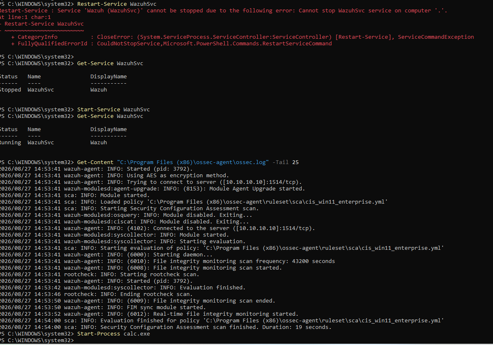
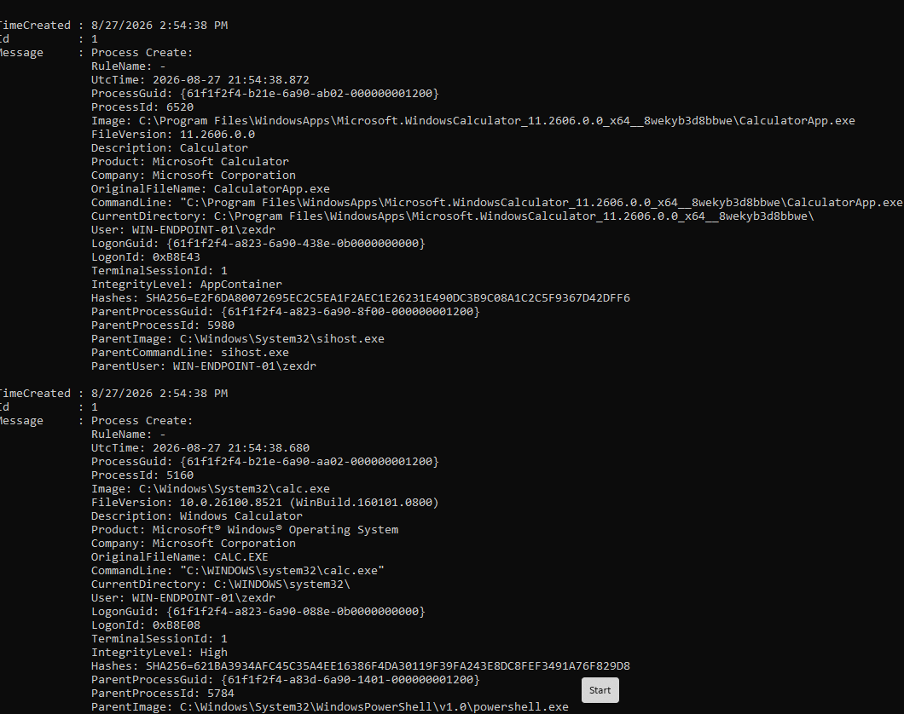
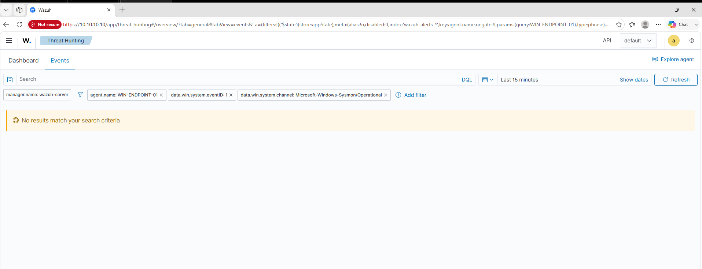
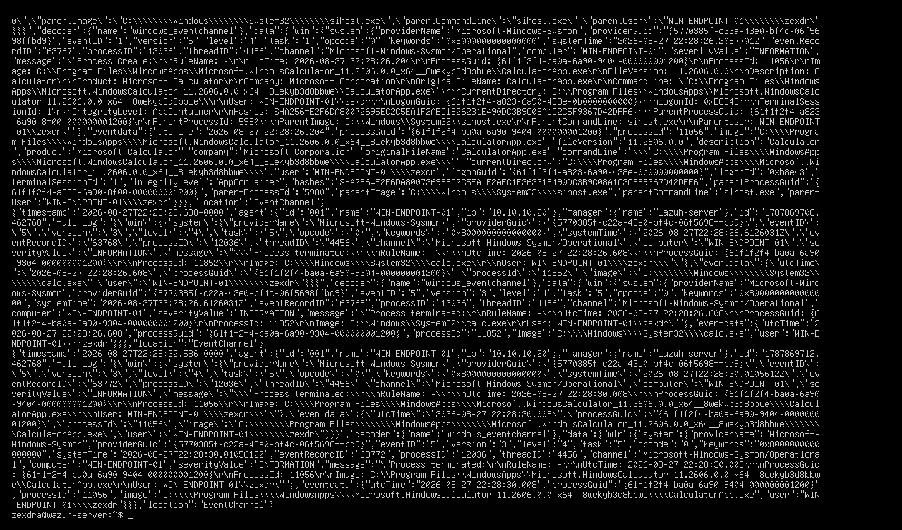
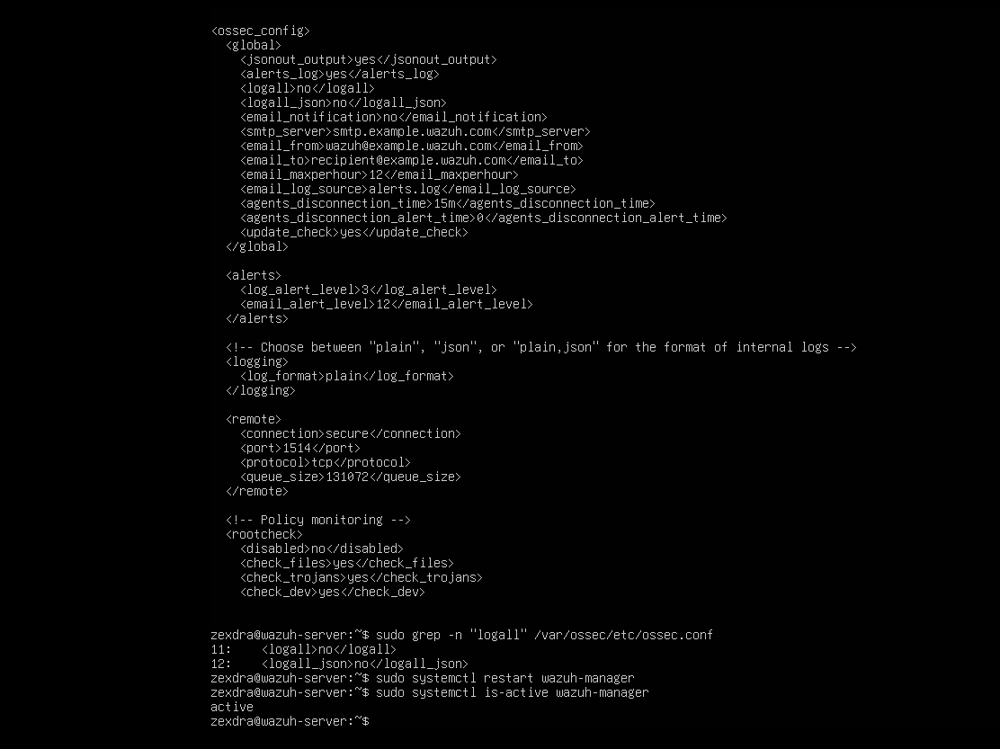

# Phase 4 — Sysmon Endpoint Telemetry

**Goal:** capture process details and hashes, connect the Sysmon channel to Wazuh, diagnose overload, tune noise, and prove raw delivery.

## Why Sysmon

Sysmon Event ID 1 (Process Create) records the image path, command line, user, integrity level, parent image and command line, process/parent IDs, process GUID, and hashes (SHA256).

A process name alone is weak evidence. Parent→child chains and command lines show *how* something started. PowerShell → Calculator is benign here, but the same reasoning catches Office → PowerShell → unknown.exe.

## Enabling Sysmon

This Windows 11 build ships Sysmon as an **optional feature**:

```powershell
Get-Service sysmon*
Get-WindowsOptionalFeature -Online -FeatureName Sysmon
Enable-WindowsOptionalFeature -Online -FeatureName Sysmon -All
sysmon -s | Select-Object -First 15   # inspect supported schema
```

"Enabled" didn't mean useful telemetry yet. It still needed a config and installation.

## Config v1: broad visibility

[`configs/sysmon/sysmonconfig-broad.xml`](../configs/sysmon/sysmonconfig-broad.xml) logged SHA256 plus ProcessCreate, NetworkConnect, FileCreate, RegistryEvent and DNSQuery.

```powershell
sysmon -accepteula -i C:\Sysmon\sysmonconfig.xml
Start-Process notepad.exe
Get-WinEvent -FilterHashtable @{LogName='Microsoft-Windows-Sysmon/Operational'; Id=1} -MaxEvents 3 |
  Format-List TimeCreated,Id,Message
```

Local Event ID 1 appeared with image, command line, user, integrity level, parent and SHA256. That proved Sysmon worked **before** any Wazuh collection was involved.

## Collecting Sysmon in Wazuh

Added inside the last `</ossec_config>` of the agent's `ossec.conf` (backed up first):

```xml
<localfile>
  <location>Microsoft-Windows-Sysmon/Operational</location>
  <log_format>eventchannel</log_format>
</localfile>
```

`wazuh-agent.exe -t` isn't supported by this agent build, so the XML was validated with `[xml](Get-Content ... -Raw)` plus the agent log.

## Problem: agent buffer flooding

```
Agent buffer at 90%
Agent buffer is full: Events may be lost
Agent buffer is flooded: Producing too many events
```

Five broad event categories (1, 3, 11, 12–14, 22) produced more events than the agent could ship.

> More logs are not automatically better. Useful visibility must fit the collection and transport capacity.

**Fix:** keep the broad config as a backup and switch to [Process Create only](../configs/sysmon/sysmonconfig-process-create.xml):

```powershell
Copy-Item C:\Sysmon\sysmonconfig.xml C:\Sysmon\sysmonconfig-broad.xml -Force
sysmon -c C:\Sysmon\sysmonconfig.xml
sysmon -c   # now shows only ProcessCreate
```

The buffer dropped back below 70%. Network, file, registry and DNS will be added back selectively later.

## Problem: Restart-Service "failed"

`Restart-Service WazuhSvc` reported the service couldn't be stopped, but `Get-Service` showed it was actually **Stopped**. `Start-Service` brought it back, and the agent log confirmed reconnection to `10.10.10.10:1514`.



## Test event: Calculator

Local Sysmon captured Event ID 1 for `CalculatorApp.exe` and `calc.exe`, with SHA256 and parent process (PowerShell → calc.exe).



## "No results" ≠ pipeline failure

Threat Hunting with `agent.name = WIN-ENDPOINT-01`, `eventID = 1` and channel Sysmon/Operational returned **nothing**. The filters were right. Threat Hunting searches `wazuh-alerts-*`, and normal Calculator activity doesn't match an alert-generating rule.



## Proving delivery with raw archives

Temporarily enabled `logall_json` on the manager:

```bash
sudo cp /var/ossec/etc/ossec.conf /var/ossec/etc/ossec.conf.phase4-backup
# set <logall_json>yes</logall_json>, then:
sudo systemctl restart wazuh-manager
sudo grep -iE 'calc.exe|CalculatorApp.exe' /var/ossec/logs/archives/archives.json | tail -n 5
```

`archives.json` contained agent 001 / WIN-ENDPOINT-01 / 10.10.10.20 Sysmon Event ID 1 records with SHA256 and parent fields. That proves the full pipeline.



Then **turned raw archiving back off** (`<logall>no</logall>`, `<logall_json>no</logall_json>`) so every raw event isn't stored indefinitely:



## Outcome

```
Process starts → Sysmon Event 1 → Wazuh agent → TCP 1514 → Wazuh manager → raw archive proof
```

- ✅ Built-in Sysmon enabled with SHA256
- ✅ Sysmon channel collected by the agent
- ✅ Buffer flooding diagnosed and resolved by tuning
- ✅ Raw delivery proven; `logall_json` disabled again
- 📸 Snapshots: `Sysmon-Wazuh-Integration-Working`, `Wazuh-Sysmon-Telemetry-Verified`
