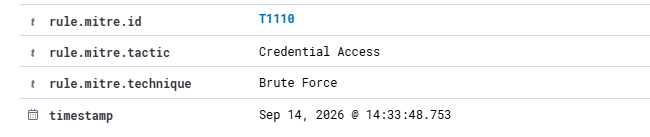
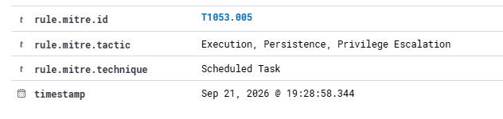
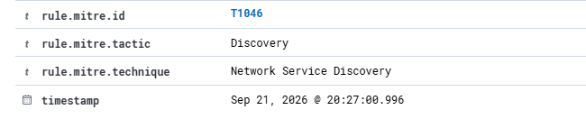

# Phase 8 — MITRE ATT&CK Mapping

**Completed:** 2026-09-27
**Goal:** verify every custom detection against MITRE ATT&CK and document the full chain for each: attack behavior → telemetry → detection logic → tactic/technique → analyst context.

> **Sources:** the custom rules from [Phase 7](phase-07-detection-engineering.md) and the milestone snapshot notes from both VMs.

## Detection-to-ATT&CK map

| Technique | Tactic | Lab behavior | Telemetry | Detection | Analyst context |
|---|---|---|---|---|---|
| **T1110** Brute Force | Credential Access | Repeated failed logons (SMB and other remote auth) from Kali | Windows Security failed logons → Wazuh 60122 | **100100**: 5 failures / 120 s | Check the source IP and target account; look for a following *successful* logon (possible compromise) |
| **T1053.005** Scheduled Task | Persistence (also Execution, Privilege Escalation) | `schtasks /Create` on the endpoint | Sysmon Event 1 (image + command line) | **100110** | Review the task name, action, trigger and run-as user; the parent process shows who created it |
| **T1046** Network Service Discovery | Discovery | Port probing from Kali against the endpoint | WFP Event 5157 (blocked TCP) | **100120** → **100121**: 3+ different ports / 30 s, same src→dst | Source in an expected scanner list? Followed by auth attempts on an open port? |

## Coverage from built-in rules (Phase 6)

| Behavior | Detected by | ATT&CK (reference) |
|---|---|---|
| Remote failed authentication (single events) | Built-in Wazuh rules | T1110 |
| Nested PowerShell | Built-in Wazuh rules | T1059.001 |
| Base64-encoded PowerShell | Built-in Wazuh rules | T1059.001, T1027 |

## Kill-chain view of what the lab now sees

```
Discovery (T1046)  →  Credential Access (T1110)  →  Execution (T1059.001)  →  Persistence (T1053.005)
     100121               100100 + built-ins            built-ins                 100110
```

An attacker following the simulated path in Phase 6 now creates an alert at **every stage**.

## Evidence

Each custom detection carries its MITRE mapping through to the Wazuh event, shown here in the dashboard's `rule.mitre` fields:

**T1110 — Brute Force** (Credential Access):



**T1053.005 — Scheduled Task** (Execution / Persistence / Privilege Escalation):



**T1046 — Network Service Discovery** (Discovery):



## 📝 Still to add

- [ ] A consolidated ATT&CK Navigator layer showing all covered techniques at once

## Outcome

- ✅ Custom detections verified against T1110, T1053.005 and T1046
- ✅ Behavior, telemetry, logic, tactic/technique and analyst context documented
- 📸 Snapshots: `Phase-8-MITRE-ATTACK-Mapping-Complete` (both VMs)
