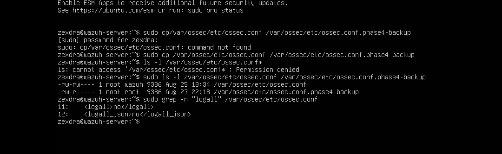

# Troubleshooting Log

Recurring pattern: **read the error literally → verify the current state → fix the smallest thing → rerun the health check.**

| Phase | Symptom | Cause | Fix |
|---|---|---|---|
| 1 | Netplan didn't apply static IP | Used `dhcp` instead of `dhcp4` | Corrected key, `netplan generate && apply` |
| 1 | Windows 11 install refused | No TPM 2.0 on VM | Added virtual TPM |
| 1 | Kali profile half-configured, huge autocomplete list | Bad `nmcli` command | Deleted profile, rebuilt cleanly |
| 1 | Kali → Windows ping failed (others OK) | Windows Firewall blocks inbound ICMP | Scoped allow rule for 10.10.10.0/24, firewall kept on |
| 2 | Installer re-run said components exist | Accidental second run | Stopped; never `--overwrite` a working install |
| 2 | `filebeat` inactive | Service not started/enabled | `systemctl start/enable filebeat`, `filebeat test output` |
| 2 | Password change rejected | `@` not allowed by policy | Used an allowed symbol (`* + ? - .`) |
| 2 | `curl -so` didn't save the file as expected | Lowercase `o` instead of `-O` | `curl -sO` |
| 4 | Agent buffer 90% → full → flooded | Broad Sysmon config (5 categories) | Reduced to ProcessCreate only |
| 4 | `wazuh-agent.exe -t` failed | Switch unsupported in this build | Validated XML with `[xml](Get-Content -Raw)` + agent log |
| 4 | `Restart-Service WazuhSvc` error | Stop timed out; service was actually Stopped | `Get-Service` → `Start-Service`, confirmed via `ossec.log` |
| 4 | Threat Hunting: no Sysmon Event 1 results | Searches `wazuh-alerts-*`; benign process didn't trigger a rule | Proved delivery with `archives.json` instead |
| 4 | `sudo cp` "command not found" / permission denied | Missing space after `cp`, missing `sudo` | Corrected command spacing and privilege |

